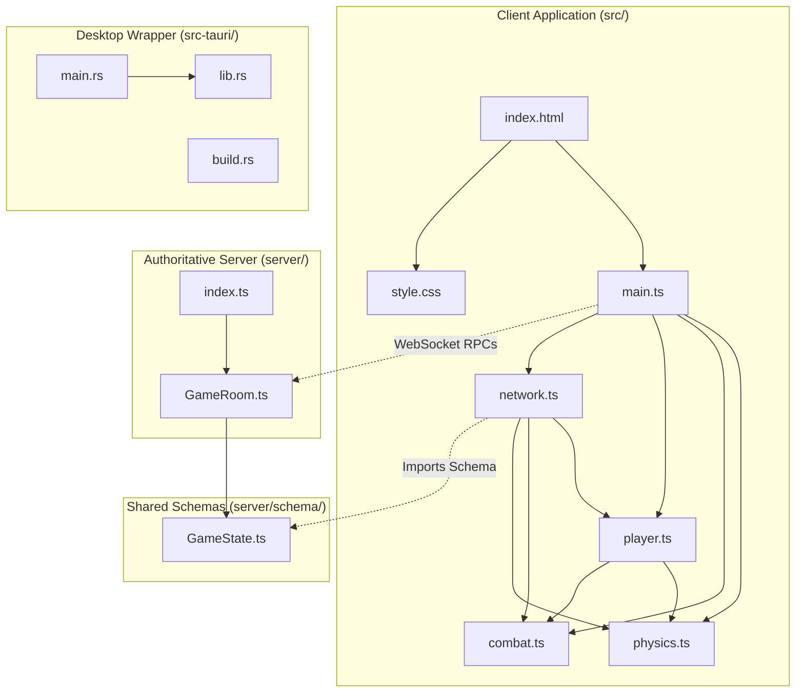

# Operation DeltaZero (multiplayer-cylinder) — Codebase Audit & Architectural Overview

> **Audit Date:** October 26, 2026  
> **Auditor Role:** Senior Software Engineer  
> **Repository Root:** `/home/turab/Projects/multiplayer-cylinder`  
> **Audit Nature:** Read-Only Codebase Assessment  

---

## 1. Project Summary

### 1.1 Purpose & Problem Solved
**Operation DeltaZero** (`multiplayer-cylinder`) is an asymmetrical multiplayer arena combat game built with WebGL/WebGPU technologies and packaged for desktop deployment. The game models tactical adversarial skirmishes between two distinct operative archetypes:
1. **The Mercenary (`Merc`)**: A first-person shooter (FPS) combat specialist equipped with an M4A1 assault rifle featuring procedurally simulated recoil springs, weapon sway, walking/breathing weapon bob, tactical reload cycles, muzzle flashes, and ballistic ray-traced projectile physics.
2. **The Spy (`Spie`)**: A third-person tactical operative utilizing high-mobility acrobatics, including weighted animation blending (idle, walk, run, crouch transitions, crouched walking), dynamic parkour mantling onto elevated geometry (detecting climbable ledges between waist level and 1.7× body height), and a hit-zone-segmented health model (100 HP max; taking 50 damage on headshots, 25 on torso hits, and 10 on limb hits).

The application addresses the problem of delivering low-latency, deterministic 3D physics and skeletal character animation across both standard web browsers and lightweight native desktop binaries (Linux `.deb`/`.AppImage` and Windows x64 `.exe`) without requiring heavy runtime engines like Unreal or Unity.

---

### 1.2 Tech Stack & Dependencies

| Layer | Technology / Library | Version | Role in Project |
| :--- | :--- | :--- | :--- |
| **Language (Frontend/Server)** | TypeScript | `^5.6.3` | Strong typing, interfaces, and module bundling across client and server. |
| **Language (Desktop Shell)** | Rust | `2021 Edition` | Native desktop windowing, OS integration, and cross-platform packaging. |
| **Rendering Engine** | `@babylonjs/core` | `^7.33.0` | 3D scene graph, camera control, lighting, materials, and GLTF/GLB loading. |
| **Asset Loaders** | `@babylonjs/loaders` | `^7.33.0` | GLTF/GLB parsing and skeletal animation container loading. |
| **Physics Engine** | `@dimforge/rapier3d-compat` | `^0.14.0` | WASM-based deterministic 3D rigid-body simulation, colliders, and raycasting. |
| **Networking (Client)** | `colyseus.js` | `^0.15.24` | WebSocket client, room subscription, and schema delta decoding. |
| **Networking (Server)** | `colyseus` | `^0.15.42` | Authoritative multiplayer room management, state synchronization, client sessions. |
| **State Serialization** | `@colyseus/schema` | `^2.0.36` | Binary delta-encoded schema definition and replication. |
| **Server Transport** | `@colyseus/ws-transport` | bundled | WebSocket transport binding to native Node.js HTTP server. |
| **Desktop Wrapper** | `@tauri-apps/cli` / `tauri` | `2.0.0` | Webview runner, native packaging, cross-compilation harness. |
| **Build & Dev Tool** | `vite` | `^5.4.10` | Client dev server, HMR, bundling, and asset pipeline. |
| **Server Runner** | `tsx` | `^4.19.1` | Native TypeScript execution for the Colyseus game server. |
| **Cross Toolchain** | `cargo-xwin` / `xwin` | v0.6.5+ | Linux-to-Windows cross-compilation with MSVC CRT and Windows SDKs. |

---

### 1.3 Installation, Configuration, Execution & Testing

#### Prerequisites
- Node.js (v18.0.0 or higher) and `npm`
- Rust toolchain (`cargo`, `rustc` 1.75+)
- Linux system libraries for Tauri (if building native desktop packages): `libwebkit2gtk-4.1-dev`, `build-essential`, `curl`, `wget`, `file`, `libxdo-dev`, `libssl-dev`, `libayatana-appindicator3-dev`, `librsvg2-dev`

#### Installation
```bash
# Clone and enter directory
cd /home/turab/Projects/multiplayer-cylinder

# Install client and server dependencies
npm install
```

#### Running in Development Mode
The application consists of two concurrent processes: the Colyseus authoritative server and the Vite frontend client.
```bash
# Terminal 1: Start authoritative game server (WebSocket on port 2567)
npm run server

# Terminal 2: Start Vite frontend client (HTTP on port 5173)
npm run dev
```

#### Running as a Native Desktop App (Tauri)
```bash
npm run tauri dev
```

#### Building Desktop Release Artifacts
```bash
# Native Linux build (.deb and .AppImage into release/linux/)
npm run build:linux

# Cross-compile Windows x64 .exe from Linux into release/windows/
npm run setup:toolchain    # Downloads Windows SDK & MSVC headers via xwin (once)
npm run build:windows      # Invokes cargo-xwin and bundles multiplayer-cylinder.exe
```

#### Testing
- **Automated Tests:** **NONE**. There are no unit, integration, or end-to-end test harnesses (`vitest`, `jest`, or Rust `cargo test`) configured in the repository.
- **Manual Verification:** Verify client loads at `http://localhost:5173`, server accepts WebSocket connections at `ws://localhost:2567`, character selection modal operates, Rapier colliders step without falling through the floor, and weapon firing/mantling operates smoothly.

---

### 1.4 Entry Points & Application Startup Lifecycle

#### 1. Frontend Client Entry Point: [`src/main.ts`](file:///home/turab/Projects/multiplayer-cylinder/src/main.ts)
1. **DOM Loading:** `src/index.html` loads `src/style.css` and instantiates `<canvas id="renderCanvas">` alongside the UI elements, then executes `<script type="module" src="./main.ts">`.
2. **Bootstrap Sequence (`bootstrap()` in `src/main.ts`):**
   - Instantiates Babylon.js `Engine` on `#renderCanvas` with WebGL power preferences and hardware anti-aliasing.
   - Instantiates Babylon `Scene`, sets clear color to dark slate `(0.07, 0.09, 0.15)`, and disables pointer move picking for performance.
   - Sets up ambient lighting (`HemisphericLight`).
   - Concurrently initializes the Rapier3D WASM physics world (`initPhysicsWorld()`) and preloads all GLB character containers (`loadCharacterAssets()`) while presenting the `#character-select-menu` overlay (`waitForCharacterSelection()`).
   - Builds static map colliders in Rapier and creates corresponding visual meshes for the 100×100m ground and 28 deterministic obstacles.
   - Once the user clicks "Spie" or "Mercenary", configures the camera (`ArcRotateCamera` for Spie, `UniversalCamera` viewmodel camera for Mercenary), requests pointer lock on the canvas, and instantiates `CombatEffectsManager` and `LocalPlayer`.
   - Initializes `NetworkManager` and connects to `ws://${window.location.hostname}:2567`.
   - Starts the Babylon render loop: advances Rapier physics (`world.step()`), updates local player state (`localPlayer.update()`), steps combat projectile rays and particle effects (`combatEffects.update()`), syncs network state (`network.update()`), and renders the scene (`scene.render()`).

#### 2. Server Entry Point: [`server/index.ts`](file:///home/turab/Projects/multiplayer-cylinder/server/index.ts)
1. Creates a Node.js standard HTTP server via `http.createServer()`.
2. Instantiates a Colyseus `Server` bound to `WebSocketTransport`.
3. Registers the authoritative room definition: `gameServer.define('game_room', GameRoom)`.
4. Binds to `process.env.HOST || '0.0.0.0'` and `process.env.PORT || 2567`.

#### 3. Native Desktop Entry Points: [`src-tauri/src/main.rs`](file:///home/turab/Projects/multiplayer-cylinder/src-tauri/src/main.rs) and [`src-tauri/src/lib.rs`](file:///home/turab/Projects/multiplayer-cylinder/src-tauri/src/lib.rs)
1. `main.rs` invokes `app_lib::run()` with Windows release subsystem flags.
2. `lib.rs` initializes Tauri v2 with `tauri_plugin_opener`, loads `tauri.conf.json`, binds to `http://localhost:5173` (dev) or embedded `dist` assets (production), and displays the native desktop window.

---

## 2. Directory Tree

```
multiplayer-cylinder/
├── .gitignore                          # Excludes node_modules, release, dist, and .toolchain/
├── package.json                        # Node project manifest, dependencies, and build scripts
├── package-lock.json                   # Deterministic dependency lockfile for npm
├── tsconfig.json                       # TypeScript compiler options for client and server
├── vite.config.ts                      # Vite bundler, asset paths, and dev server configuration
├── README.md                           # User-facing project documentation and gameplay overview
├── public/                             # Static binary assets served directly by Vite
│   └── assets/
│       └── characters/
│           ├── fps_merc_m4a1.glb       # First-person viewmodel and rifle mesh for Mercenary
│           ├── mercenary.glb           # Third-person world avatar mesh for Mercenary
│           ├── player.glb              # Legacy character GLB asset (currently unreferenced)
│           └── spy.glb                 # Third-person skeletal avatar & animations for Spy
├── scripts/                            # Operational shell scripts for packaging and toolchain
│   ├── build-linux.sh                  # Builds frontend and packages Linux .deb and .AppImage
│   ├── build-windows.sh                # Cross-compiles Windows x64 .exe from Linux using cargo-xwin
│   └── setup-toolchain.sh              # Configures MSVC SDK headers, clang, and cargo-xwin
├── server/                             # Authoritative Colyseus WebSocket server
│   ├── GameRoom.ts                     # Authoritative room logic, message dispatch, damage & respawn
│   ├── index.ts                        # HTTP & WebSocket transport bootstrap entry point
│   └── schema/
│       └── GameState.ts                # Colyseus Schema definitions for Player and GameState
├── src/                                # Frontend WebGL/Babylon.js client application
│   ├── combat.ts                       # Ballistic simulation, raycast hits, VFX particles & muzzle flash
│   ├── index.html                      # Single-page HTML shell, HUD containers, and canvas
│   ├── main.ts                         # Client application entry point, scene setup, and render loop
│   ├── network.ts                      # Colyseus client manager, replication, and state interpolation
│   ├── physics.ts                      # Rapier3D physics world setup, map colliders, and ground check
│   ├── player.ts                       # Local player controller, viewmodels, parkour & animation SM
│   └── style.css                       # Global styles, tactical HUD, crosshair, and selection modal
└── src-tauri/                          # Tauri v2 native desktop wrapper
    ├── Cargo.toml                      # Rust crate manifest, dependencies (tauri, serde, plugins)
    ├── Cargo.lock                      # Rust dependency lockfile
    ├── build.rs                        # Tauri build script compiling native bindings
    ├── tauri.conf.json                 # Tauri application metadata, window specs, bundle settings
    ├── capabilities/
    │   └── default.json                # Tauri v2 application permissions and window capabilities
    ├── icons/                          # Application desktop icon assets across resolutions
    │   ├── 128x128.png                 # Standard 128px icon
    │   ├── 128x128@2x.png              # High-DPI 256px icon
    │   ├── 32x32.png                   # Taskbar 32px icon
    │   ├── icon.icns                   # macOS bundled icon
    │   ├── icon.ico                    # Windows icon format
    │   ├── icon.png                    # Base master PNG icon
    │   ├── Square30x30Logo.png         # Windows store tile icon
    │   ├── Square44x44Logo.png         # Windows small tile icon
    │   ├── Square71x71Logo.png         # Windows medium tile icon
    │   ├── Square89x89Logo.png         # Windows large tile icon
    │   ├── Square107x107Logo.png       # Windows extended tile icon
    │   ├── Square142x142Logo.png       # Windows wide tile icon
    │   ├── Square150x150Logo.png       # Windows standard tile icon
    │   ├── Square284x284Logo.png       # Windows extra-large tile icon
    │   ├── Square310x310Logo.png       # Windows high-res tile icon
    │   └── StoreLogo.png               # Windows marketplace icon
    └── src/
        ├── lib.rs                      # Tauri library core, plugin initialization, and entry hook
        └── main.rs                     # Windows native entry point and subsystem configuration
```

### Excluded / Generated / Vendored Folders
The following directories exist within the project environment but are excluded from manual inspection as build artifacts or vendored code:
- `node_modules/`: Installed npm dependencies (Colyseus, Babylon.js, Rapier3D, Vite, TypeScript).
- `.git/`: Git version control tracking repository and reflogs.
- `dist/`: Output directory containing Vite-bundled client JavaScript, CSS, and HTML.
- `release/`: Packaged binary release distributions (`release/linux/*.deb`, `release/windows/*.exe`).
- `.toolchain/`: Vendored Windows SDK CRT headers, LLVM libraries, and compiler environment for cross-compiling.
- `src-tauri/target/`: Rust Cargo build cache, intermediate object files, and compiled binaries.
- `src-tauri/gen/`: Tauri auto-generated desktop schema definitions.

---

## 3. File Inventory

| Path | Lines | Primary Purpose | Imports From (Internal) | Imported By |
| :--- | :--- | :--- | :--- | :--- |
| [`src/main.ts`](file:///home/turab/Projects/multiplayer-cylinder/src/main.ts) | 298 | Client bootstrap, scene/lighting setup, game loop, UI/death coordination | [`src/physics.ts`](file:///home/turab/Projects/multiplayer-cylinder/src/physics.ts), [`src/player.ts`](file:///home/turab/Projects/multiplayer-cylinder/src/player.ts), [`src/combat.ts`](file:///home/turab/Projects/multiplayer-cylinder/src/combat.ts), [`src/network.ts`](file:///home/turab/Projects/multiplayer-cylinder/src/network.ts) | [`src/index.html`](file:///home/turab/Projects/multiplayer-cylinder/src/index.html) |
| [`src/player.ts`](file:///home/turab/Projects/multiplayer-cylinder/src/player.ts) | 2,817 | Local player controller, FPS viewmodel, recoil springs, Spy animation SM & parkour | [`src/physics.ts`](file:///home/turab/Projects/multiplayer-cylinder/src/physics.ts), [`src/combat.ts`](file:///home/turab/Projects/multiplayer-cylinder/src/combat.ts) | [`src/main.ts`](file:///home/turab/Projects/multiplayer-cylinder/src/main.ts), [`src/network.ts`](file:///home/turab/Projects/multiplayer-cylinder/src/network.ts) |
| [`src/combat.ts`](file:///home/turab/Projects/multiplayer-cylinder/src/combat.ts) | 515 | High-speed ballistic raycasting, hit dispatch, muzzle flashes, and particle VFX | None | [`src/main.ts`](file:///home/turab/Projects/multiplayer-cylinder/src/main.ts), [`src/player.ts`](file:///home/turab/Projects/multiplayer-cylinder/src/player.ts), [`src/network.ts`](file:///home/turab/Projects/multiplayer-cylinder/src/network.ts) |
| [`src/network.ts`](file:///home/turab/Projects/multiplayer-cylinder/src/network.ts) | 459 | Colyseus client synchronization, remote avatar interpolation, hit/death RPCs | [`src/player.ts`](file:///home/turab/Projects/multiplayer-cylinder/src/player.ts), [`src/combat.ts`](file:///home/turab/Projects/multiplayer-cylinder/src/combat.ts), [`src/physics.ts`](file:///home/turab/Projects/multiplayer-cylinder/src/physics.ts), [`server/schema/GameState.ts`](file:///home/turab/Projects/multiplayer-cylinder/server/schema/GameState.ts) | [`src/main.ts`](file:///home/turab/Projects/multiplayer-cylinder/src/main.ts) |
| [`src/physics.ts`](file:///home/turab/Projects/multiplayer-cylinder/src/physics.ts) | 190 | Rapier3D WASM initialization, ground/obstacle physics colliders, ground check | None | [`src/main.ts`](file:///home/turab/Projects/multiplayer-cylinder/src/main.ts), [`src/player.ts`](file:///home/turab/Projects/multiplayer-cylinder/src/player.ts), [`src/network.ts`](file:///home/turab/Projects/multiplayer-cylinder/src/network.ts) |
| [`src/index.html`](file:///home/turab/Projects/multiplayer-cylinder/src/index.html) | 63 | HTML5 layout shell, canvas, tactical HUD elements, and character select modal | [`src/style.css`](file:///home/turab/Projects/multiplayer-cylinder/src/style.css), [`src/main.ts`](file:///home/turab/Projects/multiplayer-cylinder/src/main.ts) | None (Browser entry) |
| [`src/style.css`](file:///home/turab/Projects/multiplayer-cylinder/src/style.css) | 334 | Visual styling for canvas, HUD overlays, ammo counter, health bar, and modal | None | [`src/index.html`](file:///home/turab/Projects/multiplayer-cylinder/src/index.html) |
| [`server/index.ts`](file:///home/turab/Projects/multiplayer-cylinder/server/index.ts) | 33 | HTTP server creation, Colyseus WebSocket server listener and room registration | [`server/GameRoom.ts`](file:///home/turab/Projects/multiplayer-cylinder/server/GameRoom.ts) | None (Node entry via tsx) |
| [`server/GameRoom.ts`](file:///home/turab/Projects/multiplayer-cylinder/server/GameRoom.ts) | 223 | Authoritative multiplayer game room, client validation, hit damage, and respawns | [`server/schema/GameState.ts`](file:///home/turab/Projects/multiplayer-cylinder/server/schema/GameState.ts) | [`server/index.ts`](file:///home/turab/Projects/multiplayer-cylinder/server/index.ts) |
| [`server/schema/GameState.ts`](file:///home/turab/Projects/multiplayer-cylinder/server/schema/GameState.ts) | 16 | Colyseus binary delta Schema definitions for Player and GameState | None | [`server/GameRoom.ts`](file:///home/turab/Projects/multiplayer-cylinder/server/GameRoom.ts), [`src/network.ts`](file:///home/turab/Projects/multiplayer-cylinder/src/network.ts) |
| [`src-tauri/src/main.rs`](file:///home/turab/Projects/multiplayer-cylinder/src-tauri/src/main.rs) | 13 | Windows desktop executable entry point configuring the GUI subsystem | [`src-tauri/src/lib.rs`](file:///home/turab/Projects/multiplayer-cylinder/src-tauri/src/lib.rs) | None (Rust binary entry) |
| [`src-tauri/src/lib.rs`](file:///home/turab/Projects/multiplayer-cylinder/src-tauri/src/lib.rs) | 16 | Tauri v2 desktop application builder and runtime runner | None | [`src-tauri/src/main.rs`](file:///home/turab/Projects/multiplayer-cylinder/src-tauri/src/main.rs) |
| [`src-tauri/build.rs`](file:///home/turab/Projects/multiplayer-cylinder/src-tauri/build.rs) | 3 | Cargo build script triggering `tauri_build::build()` | None | Cargo build harness |
| [`src-tauri/Cargo.toml`](file:///home/turab/Projects/multiplayer-cylinder/src-tauri/Cargo.toml) | 25 | Cargo manifest defining Rust dependencies, crate type, and metadata | None | Cargo |
| [`src-tauri/tauri.conf.json`](file:///home/turab/Projects/multiplayer-cylinder/src-tauri/tauri.conf.json) | 40 | Tauri v2 application configuration, window settings, and bundle specifications | None | Tauri CLI |
| [`src-tauri/capabilities/default.json`](file:///home/turab/Projects/multiplayer-cylinder/src-tauri/capabilities/default.json) | 11 | Tauri security capability declarations granting core and opener permissions | None | Tauri CLI |
| [`scripts/build-linux.sh`](file:///home/turab/Projects/multiplayer-cylinder/scripts/build-linux.sh) | 24 | Shell script building Vite assets and bundling Linux .deb and .AppImage packages | None | User / CI |
| [`scripts/build-windows.sh`](file:///home/turab/Projects/multiplayer-cylinder/scripts/build-windows.sh) | 28 | Shell script cross-compiling the Windows .exe using cargo-xwin | None | User / CI |
| [`scripts/setup-toolchain.sh`](file:///home/turab/Projects/multiplayer-cylinder/scripts/setup-toolchain.sh) | 85 | Shell script configuring MSVC headers, Windows SDK, and cargo-xwin environment | None | User / CI |
| [`package.json`](file:///home/turab/Projects/multiplayer-cylinder/package.json) | 41 | Project npm scripts, dependencies, devDependencies, and project metadata | None | npm / Vite |
| [`tsconfig.json`](file:///home/turab/Projects/multiplayer-cylinder/tsconfig.json) | 21 | TypeScript compiler configuration (strict mode, bundler module resolution) | None | tsc / IDE / Vite |
| [`vite.config.ts`](file:///home/turab/Projects/multiplayer-cylinder/vite.config.ts) | 19 | Vite build configuration, port mappings, and platform compilation targets | None | Vite |
| [`README.md`](file:///home/turab/Projects/multiplayer-cylinder/README.md) | 203 | User documentation, controls guide, architecture summary, and build commands | None | Developers / End Users |
| [`.gitignore`](file:///home/turab/Projects/multiplayer-cylinder/.gitignore) | 4 | Specifies untracked files (`node_modules`, `release`, `dist`, `.toolchain/`) | None | Git |

---

## 4. Per-File Detailed Breakdown

### 4.1 [`src/main.ts`](file:///home/turab/Projects/multiplayer-cylinder/src/main.ts) (298 lines)
- **Purpose:** Acts as the primary client-side bootstrap module. Sets up the Babylon.js engine, canvas, scene, lighting, map visuals, camera switching, physics world integration, and runs the central render/update loop.
- **Contents:**
  - `showCharacterSelectMenu(onSelect: (type: CharacterType) => void): void` (L26–L55): Displays the character selection modal and attaches click handlers to the Spie and Merc buttons.
  - `waitForCharacterSelection(): Promise<CharacterType>` (L56–L61): Wraps `showCharacterSelectMenu` in a Promise to pause deployment until an operative class is selected.
  - `bootstrap(): Promise<void>` (L62–L297): Core asynchronous initialization routine; initializes Babylon engine, Rapier physics, loads character assets, generates obstacle geometry, binds mouse/pointer events, connects to Colyseus, registers hit detection callbacks, and starts the render loop.
  - Execution call `void bootstrap();` (L298): Invokes the top-level async bootstrap sequence.
- **Dependencies:**
  - Internal: [`src/physics.ts`](file:///home/turab/Projects/multiplayer-cylinder/src/physics.ts), [`src/player.ts`](file:///home/turab/Projects/multiplayer-cylinder/src/player.ts), [`src/combat.ts`](file:///home/turab/Projects/multiplayer-cylinder/src/combat.ts), [`src/network.ts`](file:///home/turab/Projects/multiplayer-cylinder/src/network.ts).
  - External: `@babylonjs/core`.
- **State & Side Effects:** Directly accesses and manipulates the browser DOM (`#renderCanvas`, `#fps-counter`, `#crosshair`, `#character-select-menu`); requests browser Pointer Lock; binds global window resize and pointermove listeners; instantiates WebGL contexts.
- **Concerns Mixed:** Mixes application startup orchestration (L62–L140), procedural world mesh generation (L105–L135), DOM UI event handling (L26–L61), camera configuration (L160–L185), hit damage mapping rules (L210–L245), and main render loop scheduling (L260–L295).

---

### 4.2 [`src/player.ts`](file:///home/turab/Projects/multiplayer-cylinder/src/player.ts) (2,817 lines)
- **Purpose:** Massive monolithic controller managing the local player entity. Implements character asset loading, Mixamo skeletal retargeting and animation group blending, first-person Mercenary weapon viewmodels with procedural recoil/sway/bob springs, third-person Spy parkour mantling, Raycast ledge climbing, tactical weapon reloads, and health/ammo HUD updates.
- **Contents:**
  - `type CharacterType` (L22): String union `'Spie' | 'Merc'`.
  - `interface CharacterAssets` (L24–L28): Holds preloaded AssetContainers for Spy, FPS Merc, and third-person Mercenary.
  - `interface NetworkShotEvent` (L30–L79): Data contract for fired ballistic shots queued for network replication.
  - `interface SpieAnimContext` (L81–L92): Input and kinematic parameters used to drive weighted skeletal animation tracks.
  - `interface CharacterVisual` (L94–L106): Abstraction interface implemented by character visual representations.
  - `clamp(value, min, max): number` (L108–L115): Numeric clamp helper.
  - `normalizeMercContainerGeometry(container: AssetContainer): void` (L117–L170): Fixes flipped normals and scales on the FPS weapon model.
  - `loadCharacterAssets(scene: Scene): Promise<CharacterAssets>` (L172–L199): Asynchronously fetches `spy.glb`, `fps_merc_m4a1.glb`, and `mercenary.glb`.
  - `loadPlayerAssetContainer(scene: Scene): Promise<AssetContainer>` (L201–L213): Legacy loader function for `player.glb` (unreferenced).
  - `computeModelHeightAndBaseY(container: AssetContainer)` (L215–L236): Computes bounding box dimensions of loaded meshes.
  - `normalizeAngle(angle: number): number` (L238–L244): Clamps radians to `[-PI, PI]`.
  - `type SpieAnimationName` (L246–L261): Union of supported Spy skeletal animation clips.
  - `interface SpieTrack` (L263–L293): Track state for crossfading animation groups.
  - `resolveSpieAnimName(rawName: string): SpieAnimationName | null` (L295–L371): Maps raw GLTF animation names to canonical track identifiers.
  - `createSpieVisual(container: AssetContainer, scene: Scene): CharacterVisual` (L373–L958): Instantiates Spy hierarchy, strips translation tracks from hips to fix root motion, builds hitboxes, and updates weighted animation blends.
  - `createStaticPoseAnimationGroupAtFrame(...)` (L960–L1013): Clones a single-frame animation group to create static hold poses.
  - `createMercVisual(container: AssetContainer, scene: Scene): CharacterVisual` (L1015–L1307): Sets up first-person Mercenary arms and M4A1 viewmodel hierarchy.
  - `createMercWorldVisual(container: AssetContainer, scene: Scene): CharacterVisual` (L1309–L1451): Instantiates third-person Mercenary avatar for remote players.
  - `lerpAngleY(current, target, t): number` (L1453–L1466): Angular shortest-path interpolation.
  - `class LocalPlayer` (L1468–L2817):
    - Fields & State (L1470–L1566): Kinematic vectors, camera references, input buffers, health, ammo, recoil springs, parkour state.
    - `constructor(...)` (L1568–L1653): Binds physics body, creates visual mesh, initializes input listeners and HUD.
    - `updateAmmoHud(): void` (L1655–L1685): Updates magazine and reserve ammunition DOM readouts.
    - `takeDamage(amount: number, zone: string): void` (L1687–L1701): Decrements health, triggers flash, and checks for death.
    - `classifyHitZone(hitPoint: Vector3): 'head' | 'torso' | 'limbs'` (L1703–L1716): Segmented bounding height hitzone classifier.
    - `updateHealthHud(): void` (L1718–L1749): Updates HP number and color-shifting health bar in the HUD.
    - `triggerDamageFlash(): void` (L1751–L1757): Adds and removes `.active` CSS class on `#damage-flash`.
    - `handleDeath(): void` (L1759–L1775): Unlocks mouse pointer, clears inputs, and fires `onDeath` callback.
    - `respawn(spawnPosition, newType): void` (L1777–L1825): Re-initializes health, transforms, camera, and character visual.
    - `tryTacticalReload(): void` (L1827–L1849): Replenishes magazine from reserve rounds with timed reload state.
    - `stopFiringBurstIfNeeded(): void` (L1851–L1856): Terminates automatic firing burst interval.
    - `initInput(): void` (L1858–L1979): Registers DOM keyboard and mouse event listeners.
    - `handleMouseMove(movementX, movementY, arcCamera): void` (L1981–L2009): Adjusts FPS pitch/yaw or orbits TPS camera.
    - `setSpawnPosition(position: Vector3): void` (L2011–L2028): Teleports physics body and synchronizes mesh.
    - `consumeJumpEvent(): boolean` (L2030–L2034): Returns and clears pending jump flag.
    - `consumePendingShots(): NetworkShotEvent[]` (L2036–L2047): Flushes shot queue for network transmission.
    - `fireSingleRound(): void` (L2049–L2159): Simulates single shot, applies recoil impulse, plays muzzle flash, queues shot.
    - `update(arcCamera, dtSeconds): void` (L2161–L2168): Top-level dispatch to `updateMercFirstPerson` or `updateSpieThirdPerson`.
    - `updateMercFirstPerson(dtSeconds: number): void` (L2170–L2447): Mercenary movement, friction, spring-mass recoil, sway, and viewmodel bobbing.
    - `toggleSpieCrouch(): void` (L2449–L2475): Transitions Spy between standing and crouched states.
    - `checkClimbableLedge(): { canClimb: boolean; ... }` (L2477–L2593): Raycasts forward at chest and head levels to locate ledges.
    - `startLedgeClimb(ledge): void` (L2595–L2631): Freezes physics velocity and starts mantling interpolation.
    - `updateSpieThirdPerson(arcCamera, dtSeconds): void` (L2633–L2816): Spy locomotion, mantling curve interpolation, and animation state updates.
- **Dependencies:**
  - Internal: [`src/physics.ts`](file:///home/turab/Projects/multiplayer-cylinder/src/physics.ts), [`src/combat.ts`](file:///home/turab/Projects/multiplayer-cylinder/src/combat.ts).
  - External: `@babylonjs/core`, `@dimforge/rapier3d-compat`.
- **State & Side Effects:** Reads/writes DOM elements (`#ammo-hud`, `#health-hud`, `#damage-flash`); binds window listeners (`keydown`, `keyup`, `mousedown`, `mouseup`); modifies Rapier rigid body velocities and positions directly.
- **Concerns Mixed:** Contains almost every game system: asset loading, glTF track normalization, skeletal retargeting, 3D physics movement, parkour raycasting, recoil math, HUD DOM updates, and input processing.
- **Logical Clusters & Natural Seams (Over 300 Lines):**
  - *Cluster 1: Types & Definitions (L1–L170, L238–L293):* Character types, interfaces, mathematical clamps and normalization routines.
  - *Cluster 2: Asset Loading & Sanitization (L172–L236, L201–L213):* Async GLTF loading, container parsing, bounding box calculations.
  - *Cluster 3: Spy Skeletal Animation & Retargeting (L295–L1013):* Mixamo track resolution, hip translation stripping, static pose generation, and cross-fading.
  - *Cluster 4: Mercenary Viewmodel & World Avatars (L1015–L1451):* FPS arms viewmodel positioning, bone attachments, iron sights, and third-person Merc avatar.
  - *Cluster 5: Local Player Input & Lifecycle (L1468–L2047):* Pointer lock, keyboard events, HUD synchronization, health, damage, and death.
  - *Cluster 6: Mercenary Combat Systems (L2049–L2447):* Firing loop, tactical reloads, recoil springs, weapon sway, and viewmodel bobbing.
  - *Cluster 7: Spy Locomotion & Parkour Mantling (L2449–L2816):* Crouch state transitions, forward raycast ledge detection, and mantling position interpolation.
  - *Natural Refactoring Seams:*
    - `src/player/types.ts`: Extract types, interfaces, and mathematical utility functions.
    - `src/player/assets.ts`: Extract `loadCharacterAssets` and GLB preprocessing.
    - `src/player/visuals/SpieVisual.ts`: Extract Spy skeletal retargeting, animation blending, and hitzone logic.
    - `src/player/visuals/MercVisual.ts`: Extract FPS viewmodel and third-person Mercenary visuals.
    - `src/player/systems/WeaponSystem.ts`: Extract recoil springs, sway/bob procedural math, and firing mechanics.
    - `src/player/systems/ParkourSystem.ts`: Extract ledge raycasts and mantle position interpolation.
    - `src/player/LocalPlayer.ts`: Thin controller coordinating physics, input, active visuals, and state transitions.

---

### 4.3 [`src/combat.ts`](file:///home/turab/Projects/multiplayer-cylinder/src/combat.ts) (515 lines)
- **Purpose:** Implements ballistic projectile physics, continuous sub-frame raycast collision detection, muzzle flash billboards, impact sparks, blood splatter particles, and barrel smoke simulation.
- **Contents:**
  - `interface ActiveBullet` (L17–L24): Data structure for an in-flight projectile.
  - `interface ActiveParticle` (L25–L35): Data structure for an impact or smoke particle.
  - `interface ActiveMuzzleFlash` (L36–L44): Single-frame muzzle flash mesh tracker.
  - `orientCylinderAlongDirection(mesh, dir): void` (L45–L57): Rotates cylinder meshes along projectile velocity vectors.
  - `createMuzzleFlashMesh(scene, parentNode): Mesh` (L58–L118): Constructs crossed-quad procedural muzzle flash geometry.
  - `interface BulletHitEvent` (L119–L130): Event emitted when a projectile impacts a Rapier rigid body.
  - `class CombatEffectsManager` (L131–L515):
    - `constructor(scene: Scene, world: RAPIER.World)` (L147–L188): Allocates materials for tracers, sparks, blood, and smoke.
    - `triggerSingleFrameMuzzleFlash(flashMesh: Mesh | null): void` (L189–L207): Enables muzzle flash mesh for exactly one rendered frame.
    - `spawnBullet(origin, dir, shooterBody): void` (L209–L241): Instantiates visual tracer cylinder and registers projectile in update pool.
    - `spawnSurfaceImpact(point, normal): void` (L243–L323): Emits reflective spark particles and impact dust on obstacle hit.
    - `spawnFleshImpact(point, normal): void` (L325–L367): Emits crimson blood splatter particles when hitting an operative.
    - `spawnBarrelSmoke(muzzleNode): void` (L369–L411): Emits rising, expanding smoke puff meshes at the gun barrel.
    - `update(dtSeconds: number): void` (L413–L514): Steps bullet raycasts through Rapier world, tests collisions, triggers `onHit`, and updates particle velocities/alpha decay.
- **Dependencies:**
  - Internal: None.
  - External: `@babylonjs/core`, `@dimforge/rapier3d-compat`.
- **State & Side Effects:** Maintains internal object pools for bullets, particles, and muzzle flashes; performs sub-frame raycasts against the Rapier physics world; allocates and disposes Babylon meshes and materials dynamically.
- **Concerns Mixed:** Combines ballistic ray-intersection simulation with cosmetic visual effects (sparks, smoke, muzzle flash geometry, and materials).
- **Logical Clusters & Natural Seams (Over 300 Lines):**
  - *Cluster 1: Data Contracts & Geometry Helpers (L1–L130):* Effect interfaces, vector orientation, and procedural muzzle flash mesh generation.
  - *Cluster 2: Projectile Simulation (L131–L241, L413–L460):* In-flight bullet tracking, Rapier ray casting, and hit event dispatching.
  - *Cluster 3: Particle Effects & VFX (L243–L411, L461–L514):* Surface sparks, blood impacts, and barrel smoke physics/decay.
  - *Natural Refactoring Seams:*
    - `src/combat/types.ts`: Export interfaces (`ActiveBullet`, `BulletHitEvent`, etc.).
    - `src/combat/BallisticsEngine.ts`: Isolate raycast projectile stepping and collision dispatching.
    - `src/combat/ParticleManager.ts`: Isolate sparks, blood, and smoke particle simulation.
    - `src/combat/MuzzleFlash.ts`: Isolate muzzle flash mesh generation and single-frame visibility triggers.

---

### 4.4 [`src/network.ts`](file:///home/turab/Projects/multiplayer-cylinder/src/network.ts) (459 lines)
- **Purpose:** Manages the Colyseus client connection, serializes and transmits local player inputs/shots, binds schema listeners to replicate remote players, creates remote avatar visual meshes and Rapier hitboxes, and smoothly interpolates remote player positions and rotations.
- **Contents:**
  - `interface SyncedPlayerState` (L17–L26): Mirror interface of the server-side `Player` schema.
  - `interface SyncedRoomState` (L27–L37): Mirror interface of the server-side `GameState` schema.
  - `interface RemoteShootPayload` (L38–L47): Network message format for projectile firing.
  - `interface RemotePlayer` (L48–L56): Client-side tracking record for a connected remote peer.
  - `normalizeCharacterType(value: unknown): CharacterType` (L57–L60): Sanitizes unknown values to `'Merc'` or `'Spie'`.
  - `class NetworkManager` (L61–L459):
    - `constructor(...)` (L77–L92): Stores references to scene, local player, assets, combat manager, and physics world.
    - `connect(): Promise<void>` (L94–L111): Connects to the Colyseus server room (`'game_room'`) and binds message listeners.
    - `createRemoteVisual(type, root): CharacterVisual` (L113–L129): Spawns either a third-person Mercenary or Spy visual for a remote player.
    - `bindStateHandlers(room): void` (L131–L352): Listens to `players.onAdd`, `players.onRemove`, transform changes, and messages (`shoot`, `player_hit`, `player_died`, `respawn`). Attaches kinematic Rapier bodies to remote players for hit detection.
    - `sendPlayerHit(targetSessionId, damage, hitPoint, hitNormal): void` (L354–L362): Emits `'player_hit'` message to server.
    - `sendPlayerDied(): void` (L364–L368): Emits `'player_died'` message to server.
    - `sendRespawn(spawnPosition, characterType): void` (L370–L379): Emits `'respawn'` message to server.
    - `sendSelectCharacter(characterType): void` (L381–L389): Emits `'select_character'` message to server.
    - `update(dtSeconds: number): void` (L391–L458): Throttles local state updates to 20Hz, consumes and transmits pending shots, interpolates remote positions via `Vector3.Lerp`, and updates remote animation blend contexts.
- **Dependencies:**
  - Internal: [`src/player.ts`](file:///home/turab/Projects/multiplayer-cylinder/src/player.ts), [`src/combat.ts`](file:///home/turab/Projects/multiplayer-cylinder/src/combat.ts), [`src/physics.ts`](file:///home/turab/Projects/multiplayer-cylinder/src/physics.ts), [`server/schema/GameState.ts`](file:///home/turab/Projects/multiplayer-cylinder/server/schema/GameState.ts).
  - External: `colyseus.js`, `@babylonjs/core`, `@dimforge/rapier3d-compat`.
- **State & Side Effects:** Establishes persistent WebSocket connection; registers remote dynamic/kinematic colliders in Rapier physics; spawns and disposes Babylon meshes; transmits network packets.
- **Concerns Mixed:** Blends WebSocket networking and protocol serialization with 3D scene visual instantiation, Rapier collider management, and kinematic position interpolation.
- **Logical Clusters & Natural Seams (Over 300 Lines):**
  - *Cluster 1: Wire Protocol & Entity Interfaces (L1–L60):* Colyseus state models and payload types.
  - *Cluster 2: Room Lifecycle & Connection (L61–L130):* Client connection, error recovery, and room establishment.
  - *Cluster 3: State Deserialization & Entity Spawning (L131–L352):* Schema event listeners, remote visual instantiation, and collider registration.
  - *Cluster 4: Outgoing RPCs & Spatial Interpolation (L354–L458):* 20Hz update throttling, shot packet sending, and position/rotation lerping.
  - *Natural Refactoring Seams:*
    - `src/network/types.ts`: Protocol definitions and payload contracts.
    - `src/network/RemoteEntityManager.ts`: Spawning, tracking, interpolating, and destroying remote proxies.
    - `src/network/NetworkClient.ts`: Room connectivity, RPC transmission, and message dispatch.

---

### 4.5 [`src/physics.ts`](file:///home/turab/Projects/multiplayer-cylinder/src/physics.ts) (190 lines)
- **Purpose:** Encapsulates the Rapier3D WASM physics runtime initialization, arena colliders generation (ground and deterministic obstacles), player cylinder rigid body creation, and downward raycast ground checks.
- **Contents:**
  - Constants (L3–L9): `GROUND_WIDTH = 100`, `GROUND_DEPTH = 100`, `GROUND_THICKNESS = 1.0`, `PLAYER_RADIUS = 0.55`, `PLAYER_HALF_HEIGHT = 0.85`, `PLAYER_HEIGHT = 1.70`.
  - `interface ObstacleBoxSpec` (L11–L23): Dimensions and position specification for arena obstacles.
  - `createSeededRandom(seed: number): () => number` (L24–L37): Mulberry32 deterministic pseudo-random number generator.
  - `generateObstacleSpecs(): ObstacleBoxSpec[]` (L38–L78): Generates 4 jump-testing platforms and 28 deterministic obstacle boxes while preserving a clear central spawn zone.
  - `initPhysicsWorld(): Promise<RAPIER.World>` (L79–L87): Initializes Rapier WASM runtime and creates a World with gravity `(0, -19.81, 0)`.
  - `createGroundCollider(world: RAPIER.World): RAPIER.Collider` (L88–L107): Builds fixed cuboid ground collider centered at y = -0.5.
  - `createStaticObstacleBox(world, spec): RAPIER.RigidBody` (L108–L132): Spawns static fixed rigid body and box collider.
  - `createPlayerCylinderBody(world, x, y, z): RAPIER.RigidBody` (L133–L161): Spawns dynamic cylinder body with locked X and Z angular axes to keep the character upright.
  - `isPlayerGrounded(world, playerBody): boolean` (L162–L190): Casts short downward ray (0.18m max distance) from player base to detect ground contact.
- **Dependencies:**
  - Internal: None.
  - External: `@dimforge/rapier3d-compat`.
- **State & Side Effects:** Initializes the Rapier WASM heap and creates rigid bodies/colliders in the physics world.
- **Concerns Mixed:** Tightly focused on physics setup, but couples deterministic procedural map layout generation (`generateObstacleSpecs`) directly with low-level physics body construction.

---

### 4.6 [`src/index.html`](file:///home/turab/Projects/multiplayer-cylinder/src/index.html) (63 lines)
- **Purpose:** Primary HTML5 document structure defining the WebGL canvas, HUD overlays, crosshair, screen damage flash vignette, and operative selection modal.
- **Contents:**
  - `#fps-counter` (L10): Top-left performance monitoring label.
  - `#crosshair` (L12): Centered tactical crosshair for Mercenary first-person mode.
  - `#damage-flash` (L14): Full-screen vignette overlay container for damage feedback.
  - `#health-hud` (L16–L28): Bottom-right Spy operative health widget (`#health-value`, `#health-bar-fill`).
  - `#ammo-hud` (L30–L40): Bottom-right Mercenary tactical ammunition widget (`#ammo-rounds`, `#ammo-mags-bars`, `#ammo-mags-count`).
  - `#character-select-menu` (L42–L58): Class selection overlay card containing `#select-spie-btn` and `#select-merc-btn`.
  - `#renderCanvas` (L60): Fullscreen WebGL rendering canvas.
  - `<script type="module" src="./main.ts">` (L61): JavaScript entry point.
- **Dependencies:**
  - Internal: [`src/style.css`](file:///home/turab/Projects/multiplayer-cylinder/src/style.css), [`src/main.ts`](file:///home/turab/Projects/multiplayer-cylinder/src/main.ts).
  - External: None.
- **State & Side Effects:** Mounts DOM nodes for the application lifecycle.
- **Concerns Mixed:** Pure declarative HTML structure.

---

### 4.7 [`src/style.css`](file:///home/turab/Projects/multiplayer-cylinder/src/style.css) (334 lines)
- **Purpose:** Complete CSS stylesheet styling the full-screen canvas, tactical HUD elements, crosshair, health bars, damage flashes, and glassmorphism selection menu.
- **Contents:**
  - Reset & Canvas (L1–L27): Viewport reset, margin clearing, `#renderCanvas` fixed overlay, `.hidden` utility class.
  - `#crosshair` (L29–L63): Minimalist centered weapon crosshair built using `::before` and `::after` pseudo-elements.
  - `#ammo-hud` (L64–L135): Tactical bottom-right HUD for Mercenary, styling active round counts, magazine pips, and caliber badge.
  - `#health-hud` (L136–L235): Tactical bottom-right health widget for Spy, styling health readouts and dynamic color states (`.mid` orange, `.low` red).
  - `.damage-flash` (L236–L250): Full-screen red radial vignette flash toggled via `.active`.
  - `#character-select-menu` (L251–L334): Glassmorphism modal overlay, card shadows, hover states, and operative role buttons.
- **Dependencies:**
  - Internal: Referenced by [`src/index.html`](file:///home/turab/Projects/multiplayer-cylinder/src/index.html).
  - External: None.
- **State & Side Effects:** Injects CSS cascade into the browser page.
- **Concerns Mixed:** Contains all styling across the entire project in a single file.
- **Logical Clusters & Natural Seams (Over 300 Lines):**
  - *Cluster 1: Viewport & Layout (L1–L28)*
  - *Cluster 2: Weapon Crosshair (L29–L63)*
  - *Cluster 3: Tactical Ammunition HUD (L64–L135)*
  - *Cluster 4: Operative Health HUD (L136–L235)*
  - *Cluster 5: Damage Flash Vignette (L236–L250)*
  - *Cluster 6: Character Selection Menu (L251–L334)*
  - *Natural Refactoring Seams:* Split into `styles/base.css`, `styles/crosshair.css`, `styles/hud.css`, and `styles/menu.css`.

---

### 4.8 [`server/index.ts`](file:///home/turab/Projects/multiplayer-cylinder/server/index.ts) (33 lines)
- **Purpose:** Authoritative game server entry point. Configures standard Node.js HTTP server and Colyseus WebSocket transport, registers the game room, and begins listening for network clients.
- **Contents:**
  - Variable `port` (L6): Reads `process.env.PORT || 2567`.
  - Variable `host` (L7): Reads `process.env.HOST || '0.0.0.0'`.
  - Variable `server` (L9): Creates native HTTP server via `http.createServer()`.
  - Variable `gameServer` (L11–L15): Instantiates Colyseus `Server` with `WebSocketTransport`.
  - Room registration (L17): Registers `gameServer.define('game_room', GameRoom)`.
  - Server listener (L19–L27): Binds server to `port` and `host` with logging and process error exits.
- **Dependencies:**
  - Internal: [`server/GameRoom.ts`](file:///home/turab/Projects/multiplayer-cylinder/server/GameRoom.ts).
  - External: `http`, `colyseus`, `@colyseus/ws-transport`.
- **State & Side Effects:** Opens a TCP socket on port 2567; listens for incoming WebSocket connections; reads environment variables `PORT` and `HOST`.
- **Concerns Mixed:** Clean, single-purpose server bootstrapper.

---

### 4.9 [`server/GameRoom.ts`](file:///home/turab/Projects/multiplayer-cylinder/server/GameRoom.ts) (223 lines)
- **Purpose:** Implements the authoritative Colyseus game room logic (`GameRoom`). Manages client lifecycle, state replication, movement verification, projectile broadcasting, hit registration with health reduction, and player respawning.
- **Contents:**
  - `interface MoveMessage` (L8–L16): Inbound client transform payload.
  - `interface JumpMessage` (L17–L21): Inbound client jump indicator.
  - `interface SelectCharacterMessage` (L22–L25): Inbound class choice payload.
  - `interface ShootMessage` (L26–L34): Inbound ballistic firing event.
  - `interface JoinOptions` (L35–L42): Connection options.
  - `clamp(value, min, max): number` (L43–L46): Numeric clamp utility.
  - `sanitizeCharacterType(value: unknown): CharacterType` (L47–L50): Ensures valid class identifier.
  - `class GameRoom extends Room<GameState>` (L51–L223):
    - `maxClients = 16` (L52): Limits lobby capacity.
    - `onCreate(): void` (L54–L201): Initializes `GameState`, sets 20Hz patch rate (50ms), and registers message handlers for `'select_character'`, `'move'`, `'jump'`, `'shoot'`, `'player_hit'`, `'player_died'`, and `'respawn'`.
    - `onJoin(client: Client, options?: JoinOptions): void` (L202–L218): Allocates `Player` schema, assigns deterministic spawn point, and adds player to room state.
    - `onLeave(client: Client): void` (L219–L223): Removes player from state map.
- **Dependencies:**
  - Internal: [`server/schema/GameState.ts`](file:///home/turab/Projects/multiplayer-cylinder/server/schema/GameState.ts).
  - External: `colyseus`.
- **State & Side Effects:** Maintains authoritative in-memory state of connected clients; broadcasts network events to all peers in the room.
- **Concerns Mixed:** Combines room connection lifecycle, message routing, movement clamping, and combat damage resolution in one class.

---

### 4.10 [`server/schema/GameState.ts`](file:///home/turab/Projects/multiplayer-cylinder/server/schema/GameState.ts) (16 lines)
- **Purpose:** Defines the Colyseus binary delta-encoded schema models for synced players and global room state.
- **Contents:**
  - `type CharacterType` (L3): `'Spie' | 'Merc'`.
  - `class Player extends Schema` (L5–L13): Synced fields: `sessionId: string`, `x: number`, `y: number`, `z: number`, `rotationY: number`, `health: number` (default 100), `characterType: CharacterType` (default `'Spie'`).
  - `class GameState extends Schema` (L14–L16): Contains `players = new MapSchema<Player>()`.
- **Dependencies:**
  - Internal: None.
  - External: `@colyseus/schema`.
- **State & Side Effects:** None (declarative schema classes).
- **Concerns Mixed:** Pure schema definitions.

---

### 4.11 [`src-tauri/src/main.rs`](file:///home/turab/Projects/multiplayer-cylinder/src-tauri/src/main.rs) (13 lines)
- **Purpose:** Entry point for native desktop execution. Suppresses the Windows console window in release builds and calls `app_lib::run()`.
- **Contents:**
  - Compiler attribute `#![cfg_attr(not(debug_assertions), windows_subsystem = "windows")]` (L2).
  - `fn main()` (L4–L6): Invokes `app_lib::run()`.
- **Dependencies:**
  - Internal: [`src-tauri/src/lib.rs`](file:///home/turab/Projects/multiplayer-cylinder/src-tauri/src/lib.rs).
  - External: None.
- **State & Side Effects:** Launches desktop OS process.
- **Concerns Mixed:** None.

---

### 4.12 [`src-tauri/src/lib.rs`](file:///home/turab/Projects/multiplayer-cylinder/src-tauri/src/lib.rs) (16 lines)
- **Purpose:** Core Tauri library module. Configures the Tauri runtime builder, loads plugins (`tauri_plugin_opener`), generates application context from `tauri.conf.json`, and starts the desktop GUI event loop.
- **Contents:**
  - Attribute `#[cfg_attr(mobile, tauri::mobile_entry_point)]` (L1).
  - `pub fn run()` (L2–L8): Builds and runs the Tauri desktop context.
- **Dependencies:**
  - Internal: None.
  - External: `tauri`, `tauri_plugin_opener`.
- **State & Side Effects:** Spawns native WebKit/WebView window.
- **Concerns Mixed:** None.

---

### 4.13 [`src-tauri/build.rs`](file:///home/turab/Projects/multiplayer-cylinder/src-tauri/build.rs) (3 lines)
- **Purpose:** Cargo build script for the Tauri native binary. Runs `tauri_build::build()` during Cargo compilation.
- **Contents:**
  - `fn main() { tauri_build::build() }` (L1–L3).
- **Dependencies:**
  - External: `tauri_build`.
- **State & Side Effects:** Executes build-time code generation for Tauri bindings.
- **Concerns Mixed:** None.

---

### 4.14 [`src-tauri/Cargo.toml`](file:///home/turab/Projects/multiplayer-cylinder/src-tauri/Cargo.toml) (25 lines)
- **Purpose:** Cargo manifest for the Rust desktop wrapper.
- **Contents:**
  - Package definition: `name = "multiplayer-cylinder"`, `version = "0.1.0"`, `edition = "2021"`.
  - Library target `[lib]` with `name = "app_lib"` and crate types `staticlib`, `cdylib`, `rlib`.
  - Dependencies: `tauri = 2.0.0`, `tauri-plugin-opener = 2.0.0`, `serde`, `serde_json`.
  - Build dependencies: `tauri-build = 2.0.0`.
- **Dependencies:**
  - External: Rust crates.
- **State & Side Effects:** Directs Cargo compilation.
- **Concerns Mixed:** None.

---

### 4.15 [`src-tauri/tauri.conf.json`](file:///home/turab/Projects/multiplayer-cylinder/src-tauri/tauri.conf.json) (40 lines)
- **Purpose:** Configuration manifest for Tauri v2.
- **Contents:**
  - Metadata: Product name `"multiplayer-cylinder"`, version `"0.1.0"`, identifier `"com.multiplayer-cylinder.app"`.
  - Build commands: `beforeDevCommand: "npm run dev"`, `devUrl: "http://localhost:5173"`, `beforeBuildCommand: "npm run build"`, `frontendDist: "../dist"`.
  - App window specifications: Title `"multiplayer-cylinder"`, dimensions 800×600.
  - Bundle targets: `active: true`, targets `"all"`, icon paths.
- **Dependencies:**
  - Internal: References `../dist` and icons in `src-tauri/icons/`.
- **State & Side Effects:** None.
- **Concerns Mixed:** None.

---

### 4.16 [`src-tauri/capabilities/default.json`](file:///home/turab/Projects/multiplayer-cylinder/src-tauri/capabilities/default.json) (11 lines)
- **Purpose:** Tauri v2 security capability specification granting window permissions.
- **Contents:**
  - Grants `core:default` and `opener:default` to the `"main"` window.
- **Dependencies:**
  - Internal: References schema `../gen/schemas/desktop-schema.json`.
- **State & Side Effects:** None.
- **Concerns Mixed:** None.

---

### 4.17 [`scripts/build-linux.sh`](file:///home/turab/Projects/multiplayer-cylinder/scripts/build-linux.sh) (24 lines)
- **Purpose:** Automates the production build and packaging of Linux `.deb` and `.AppImage` desktop bundles.
- **Contents:**
  - Runs `npm run build` to compile the Vite frontend.
  - Runs `npm run tauri build` to invoke Cargo.
  - Copies output packages from `src-tauri/target/release/bundle` to `release/linux/`.
- **Dependencies:**
  - Internal: Calls `package.json` scripts.
- **State & Side Effects:** Writes files to `release/linux/`.
- **Concerns Mixed:** None.

---

### 4.18 [`scripts/build-windows.sh`](file:///home/turab/Projects/multiplayer-cylinder/scripts/build-windows.sh) (28 lines)
- **Purpose:** Automates cross-compilation of the Windows x64 executable from Linux using `cargo-xwin`.
- **Contents:**
  - Verifies presence of `.toolchain/env.sh`.
  - Sources `.toolchain/env.sh` to configure MSVC SDK paths.
  - Runs `npm run build`.
  - Executes `cargo xwin build --manifest-path src-tauri/Cargo.toml --release --target x86_64-pc-windows-msvc`.
  - Copies output `.exe` to `release/windows/multiplayer-cylinder.exe`.
- **Dependencies:**
  - Internal: Reads `.toolchain/env.sh`, invokes `src-tauri/Cargo.toml`.
- **State & Side Effects:** Writes binary to `release/windows/`.
- **Concerns Mixed:** None.

---

### 4.19 [`scripts/setup-toolchain.sh`](file:///home/turab/Projects/multiplayer-cylinder/scripts/setup-toolchain.sh) (85 lines)
- **Purpose:** Downloads and configures the Windows MSVC SDK headers and CRT libraries on Linux via `xwin`, creating a self-contained cross-compilation toolchain.
- **Contents:**
  - Verifies host tools (`curl`, `tar`, `clang`, `llvm-rc`).
  - Installs or locates `cargo-xwin` and `xwin`.
  - Downloads MSVC CRT and Windows SDK into `.toolchain/xwin`.
  - Generates `.toolchain/env.sh` with exported paths for `CC`, `CXX`, `AR`, and `RC`.
  - Writes local Cargo configuration targeting `x86_64-pc-windows-msvc`.
- **Dependencies:**
  - External: Downloads packages from Microsoft CDN via `xwin`.
- **State & Side Effects:** Modifies `.toolchain/` directory on the local disk.
- **Concerns Mixed:** Shell script handling network downloads, toolchain setup, and environment generation.

---

### 4.20 [`package.json`](file:///home/turab/Projects/multiplayer-cylinder/package.json) (41 lines)
- **Purpose:** Node.js package manifest defining npm scripts, dependencies, devDependencies, and module configurations.
- **Contents:**
  - Scripts: `dev`, `build`, `preview`, `server`, `tauri`, `build:linux`, `build:windows`, `setup:toolchain`.
  - Dependencies: `@babylonjs/core`, `@babylonjs/loaders`, `@colyseus/schema`, `@dimforge/rapier3d-compat`, `colyseus`, `colyseus.js`.
  - DevDependencies: `@tauri-apps/cli`, `typescript`, `vite`, `tsx`.
- **Dependencies:**
  - External: npm registry.
- **State & Side Effects:** Governs dependency installation and script execution.
- **Concerns Mixed:** None.

---

### 4.21 [`tsconfig.json`](file:///home/turab/Projects/multiplayer-cylinder/tsconfig.json) (21 lines)
- **Purpose:** TypeScript compiler configuration for client and server code.
- **Contents:**
  - Compiler options: Target `ES2020`, Module `ESNext`, Module Resolution `bundler`, `strict: true`, `noUnusedLocals: true`, `noUnusedParameters: true`.
  - Inclusions: `["src", "server"]`.
- **Dependencies:**
  - Internal: Governs TypeScript parsing across `src/` and `server/`.
- **State & Side Effects:** None.
- **Concerns Mixed:** None.

---

### 4.22 [`vite.config.ts`](file:///home/turab/Projects/multiplayer-cylinder/vite.config.ts) (19 lines)
- **Purpose:** Vite bundler and dev server configuration.
- **Contents:**
  - Server configuration: `port: 5173`, `strictPort: true`.
  - Platform compilation target matching: `chrome105` for Windows target, `safari13` for WebKit/Linux.
  - Conditional minification and sourcemap emission based on `TAURI_DEBUG`.
- **Dependencies:**
  - External: `vite`.
- **State & Side Effects:** Directs development server and bundling output.
- **Concerns Mixed:** None.

---

### 4.23 [`README.md`](file:///home/turab/Projects/multiplayer-cylinder/README.md) (203 lines)
- **Purpose:** High-level project documentation, architecture explanation, operative class guide, controls list, and build guide.
- **Contents:**
  - Overview of DeltaZero gameplay and operative classes.
  - Architecture breakdown of frontend, server, and desktop layers.
  - Control mappings for keyboard and mouse.
  - Step-by-step developer setup and native packaging instructions.
- **Dependencies:** None.
- **State & Side Effects:** Markdown documentation.
- **Concerns Mixed:** None.

---

### 4.24 [`.gitignore`](file:///home/turab/Projects/multiplayer-cylinder/.gitignore) (4 lines)
- **Purpose:** Prevents temporary and generated build artifacts from entering Git history.
- **Contents:**
  - Ignores: `node_modules`, `release`, `dist`, `.toolchain/`.
- **Dependencies:** None.
- **State & Side Effects:** Git tracking filter.
- **Concerns Mixed:** None.

---

## 5. Architecture and Data Flow

### 5.1 Request / Data / Control Flow for Key Features

#### Flow 1: Client Startup & Operative Deployment
```
Browser / WebView Loads index.html
  │
  ├─► main.ts: bootstrap()
  │     │
  │     ├─► initPhysicsWorld() [Rapier WASM loaded & World created]
  │     ├─► loadCharacterAssets() [Preloads spy.glb, fps_merc_m4a1.glb, mercenary.glb]
  │     └─► waitForCharacterSelection() [Displays #character-select-menu modal]
  │
  ├─► User clicks "Mercenary" or "Spie"
  │     │
  │     ├─► Canvas captures Pointer Lock
  │     ├─► LocalPlayer instantiated with selected CharacterType
  │     ├─► Camera selected (fpCamera for Merc; ArcRotateCamera for Spie)
  │     ├─► NetworkManager.connect() connects to ws://<host>:2567
  │     └─► NetworkManager.sendSelectCharacter(type) sent to GameRoom
  │
  └─► main.ts starts Babylon render loop:
        world.step() -> localPlayer.update() -> combatEffects.update() -> network.update() -> scene.render()
```

#### Flow 2: Mercenary Firing, Ballistics & Network Replication
```
User Left-Clicks (Mercenary)
  │
  ├─► LocalPlayer.fireSingleRound()
  │     │
  │     ├─► Deducts ammo (ammoInMag--) & updates #ammo-hud
  │     ├─► Applies spring impulse to recoilSpring (pitch + yaw kick)
  │     ├─► CombatEffectsManager.triggerSingleFrameMuzzleFlash()
  │     ├─► CombatEffectsManager.spawnBullet(origin, forwardDir)
  │     └─► Enqueues NetworkShotEvent in pendingShots queue
  │
  ├─► network.update() consumes pendingShots
  │     └─► Sends 'shoot' message to Colyseus GameRoom via WebSocket
  │
  ├─► Server GameRoom receives 'shoot'
  │     └─► Broadcasts 'shoot' message to all OTHER connected clients
  │
  └─► Remote Clients receive 'shoot'
        └─► CombatEffectsManager.spawnBullet() spawned locally with visual tracer
```

#### Flow 3: Spy Parkour Mantling & Animation Blending
```
User Moves WASD + Presses Space near an Obstacle (Spy)
  │
  ├─► LocalPlayer.updateSpieThirdPerson()
  │     │
  │     ├─► isPlayerGrounded() confirms ground contact
  │     ├─► checkClimbableLedge() casts horizontal ray at chest level & downward ray
  │     │     └─► Ledge detected (obstacle top between waist height & 1.7x body height)
  │     │
  │     └─► startLedgeClimb()
  │           ├─► Locks physics body velocity (0, 0, 0)
  │           ├─► Sets isClimbing = true
  │           ├─► Records climbStartPos and calculates climbTargetPos on top of obstacle
  │           └─► Sets SpieAnimContext { isClimbing: true, climbProgress: 0 }
  │
  ├─► In subsequent frames during mantle:
  │     ├─► S-curve ease interpolates mesh position toward climbTargetPos
  │     └─► SpieVisual blends animation track to 'hang-to-crouch'
  │
  └─► Mantle completes:
        ├─► Player placed firmly on top of obstacle
        ├─► Enters crouch state: isCrouching = true
        └─► SpieVisual blends animation track to 'crouch-idle'
```

#### Flow 4: Bullet Hit Detection, Hit Zones, Damage Flash, Death & Respawn
```
CombatEffectsManager.update() steps in-flight projectile ray
  │
  ├─► Rapier world.castRay() intersects player cylinder collider
  │     └─► Fires combatEffects.onHit(event) callback
  │
  ├─► main.ts onHit handler executes:
  │     ├─► Checks body.userData:
  │     │     ├─► If Local Spy:
  │     │     │     ├─► localPlayer.classifyHitZone(hitPoint)
  │     │     │     │     └─► 'head' (50 dmg), 'torso' (25 dmg), 'limbs' (10 dmg)
  │     │     │     └─► localPlayer.takeDamage(amount, zone)
  │     │     │           ├─► Triggers #damage-flash red vignette
  │     │     │           └─► Updates #health-hud (HP number & fill bar)
  │     │     │
  │     │     └─► If Remote Spy:
  │     │           ├─► visual.getHitZone(hitPoint) -> damage calculated
  │     │           └─► network.sendPlayerHit(targetSessionId, damage, zone)
  │     │
  │     └─► (If remote hit) GameRoom applies damage to target player in schema:
  │           └─► Broadcasts 'player_hit' to target client
  │
  └─► If Local Player HP <= 0:
        ├─► localPlayer.handleDeath() releases pointer lock & fires onDeath
        ├─► network.sendPlayerDied() notifies server
        ├─► main.ts shows #character-select-menu
        ├─► User selects new operative class
        ├─► localPlayer.respawn() resets HP to 100 & relocates player
        ├─► network.sendRespawn() updates server state
        └─► Pointer lock re-engaged on canvas
```

---

### 5.2 Internal Dependency Map



#### Textual Import Relationships:
- `src/main.ts` ➔ imports `src/physics.ts`, `src/player.ts`, `src/combat.ts`, `src/network.ts`
- `src/player.ts` ➔ imports `src/physics.ts`, `src/combat.ts`
- `src/network.ts` ➔ imports `src/player.ts`, `src/combat.ts`, `src/physics.ts`, `server/schema/GameState.ts`
- `src/combat.ts` ➔ *no internal imports*
- `src/physics.ts` ➔ *no internal imports*
- `server/index.ts` ➔ imports `server/GameRoom.ts`
- `server/GameRoom.ts` ➔ imports `server/schema/GameState.ts`
- `src-tauri/src/main.rs` ➔ imports `src-tauri/src/lib.rs`

### 5.3 Circular Dependencies
**Result:** **ZERO (0) Circular Dependencies Detected.**  
The module dependency graph is a strict Directed Acyclic Graph (DAG). `physics.ts` and `combat.ts` operate as pure leaf modules. `player.ts` consumes both. `network.ts` consumes `player.ts`, `combat.ts`, `physics.ts`, and the shared schema `GameState.ts`. `main.ts` orchestrates all client modules.

---

## 6. Configuration and Environment

### 6.1 Configuration Files
- [`package.json`](file:///home/turab/Projects/multiplayer-cylinder/package.json): Defines npm script aliases, runtime dependencies, and dev toolchains.
- [`tsconfig.json`](file:///home/turab/Projects/multiplayer-cylinder/tsconfig.json): TypeScript configuration (strict typing, module resolution).
- [`vite.config.ts`](file:///home/turab/Projects/multiplayer-cylinder/vite.config.ts): Vite build settings, dev server port (5173), and webview platform compilation targets.
- [`src-tauri/tauri.conf.json`](file:///home/turab/Projects/multiplayer-cylinder/src-tauri/tauri.conf.json): Tauri desktop metadata, bundle identifiers, window dimensions (800×600), and dev URLs.
- [`src-tauri/Cargo.toml`](file:///home/turab/Projects/multiplayer-cylinder/src-tauri/Cargo.toml): Cargo dependencies and Rust compiler flags.
- [`src-tauri/capabilities/default.json`](file:///home/turab/Projects/multiplayer-cylinder/src-tauri/capabilities/default.json): Window security capabilities.
- [`.gitignore`](file:///home/turab/Projects/multiplayer-cylinder/.gitignore): File exclusion rules for Git.

### 6.2 Environment Variables

| Variable Name | Defined / Read Location | Default Value | Purpose |
| :--- | :--- | :--- | :--- |
| `PORT` | [`server/index.ts`](file:///home/turab/Projects/multiplayer-cylinder/server/index.ts) | `2567` | Port number for the Colyseus WebSocket server. |
| `HOST` | [`server/index.ts`](file:///home/turab/Projects/multiplayer-cylinder/server/index.ts) | `'0.0.0.0'` | Network interface binding for the Colyseus game server. |
| `TAURI_PLATFORM` | [`vite.config.ts`](file:///home/turab/Projects/multiplayer-cylinder/vite.config.ts) | *Undefined* | Detected target OS (`'windows'`) to choose JS compilation target (`chrome105` vs `safari13`). |
| `TAURI_DEBUG` | [`vite.config.ts`](file:///home/turab/Projects/multiplayer-cylinder/vite.config.ts) | *Undefined* | Toggles esbuild minification and sourcemap generation in Vite. |

### 6.3 Hardcoded Constants Controlling Gameplay Behavior

| Constant Name | File Location | Value | Description |
| :--- | :--- | :--- | :--- |
| `GROUND_WIDTH` / `GROUND_DEPTH` | [`src/physics.ts`](file:///home/turab/Projects/multiplayer-cylinder/src/physics.ts) | `100` | Arena dimensions in meters. |
| `PLAYER_RADIUS` | [`src/physics.ts`](file:///home/turab/Projects/multiplayer-cylinder/src/physics.ts) | `0.55` | Radius of player physics cylinder. |
| `PLAYER_HALF_HEIGHT` | [`src/physics.ts`](file:///home/turab/Projects/multiplayer-cylinder/src/physics.ts) | `0.85` | Half-height of player physics cylinder (total height 1.70m). |
| Gravity Vector | [`src/physics.ts`](file:///home/turab/Projects/multiplayer-cylinder/src/physics.ts) | `(0, -19.81, 0)` | Earth gravity scaled up 2× for snappy arena movement. |
| Max Lobby Clients | [`server/GameRoom.ts`](file:///home/turab/Projects/multiplayer-cylinder/server/GameRoom.ts) | `16` | Maximum players per server room. |
| Patch Rate | [`server/GameRoom.ts`](file:///home/turab/Projects/multiplayer-cylinder/server/GameRoom.ts) | `50ms` (20Hz) | Server delta broadcast frequency. |
| Hit Zone Damage (`head`) | [`src/main.ts`](file:///home/turab/Projects/multiplayer-cylinder/src/main.ts), [`server/GameRoom.ts`](file:///home/turab/Projects/multiplayer-cylinder/server/GameRoom.ts) | `50` | Damage subtracted on headshot. |
| Hit Zone Damage (`torso`) | [`src/main.ts`](file:///home/turab/Projects/multiplayer-cylinder/src/main.ts), [`server/GameRoom.ts`](file:///home/turab/Projects/multiplayer-cylinder/server/GameRoom.ts) | `25` | Damage subtracted on chest/torso hit. |
| Hit Zone Damage (`limbs`) | [`src/main.ts`](file:///home/turab/Projects/multiplayer-cylinder/src/main.ts), [`server/GameRoom.ts`](file:///home/turab/Projects/multiplayer-cylinder/server/GameRoom.ts) | `10` | Damage subtracted on arm or leg hit. |
| Magazine Capacity | [`src/player.ts`](file:///home/turab/Projects/multiplayer-cylinder/src/player.ts) | `30` | M4A1 magazine round limit. |
| Reserve Magazines | [`src/player.ts`](file:///home/turab/Projects/multiplayer-cylinder/src/player.ts) | `4` | M4A1 spare magazine count. |

---

## 7. Data Layer

The project does not use a persistent SQL or NoSQL database. All shared state is held in transient memory within the Colyseus server process and serialized across WebSockets via Colyseus Schema binary delta encoding.

### 7.1 Authoritative Schema Definitions ([`server/schema/GameState.ts`](file:///home/turab/Projects/multiplayer-cylinder/server/schema/GameState.ts))

#### `Player` (extends `Schema`)
| Field | Type | Default | Description |
| :--- | :--- | :--- | :--- |
| `sessionId` | `string` | `""` | Unique Colyseus client session identifier. |
| `x` | `number` | `0` | World position X coordinate. |
| `y` | `number` | `0` | World position Y coordinate. |
| `z` | `number` | `0` | World position Z coordinate. |
| `rotationY` | `number` | `0` | Horizontal yaw rotation angle in radians. |
| `health` | `number` | `100` | Current operative health points (0–100). |
| `characterType` | `CharacterType` | `'Spie'` | Chosen operative archetype (`'Spie'` or `'Merc'`). |

#### `GameState` (extends `Schema`)
| Field | Type | Description |
| :--- | :--- | :--- |
| `players` | `MapSchema<Player>` | Keyed dictionary of connected players indexed by `sessionId`. |

### 7.2 Real-Time Network Message Contracts

| Message Type | Direction | Payload Structure | Handler / Action |
| :--- | :--- | :--- | :--- |
| `'select_character'` | Client ➔ Server | `{ characterType: 'Spie' \| 'Merc' }` | Updates player schema `characterType`. |
| `'move'` | Client ➔ Server | `{ x: number, y: number, z: number, rotationY: number }` | Validates coordinates and updates player schema transform. |
| `'jump'` | Client ➔ Server | `{ jumped: boolean }` | Relayed to room observers. |
| `'shoot'` | Client ➔ Server ➔ Peers | `{ originX, originY, originZ, targetX, targetY, targetZ }` | Replicates bullet tracer VFX across clients. |
| `'player_hit'` | Client ➔ Server ➔ Target | `{ targetSessionId: string, damage: number, hitPoint?: {...}, hitNormal?: {...} }` | Decrements target `Player.health`, broadcasts damage event. |
| `'player_died'` | Client ➔ Server ➔ Peers | `{}` | Broadcasts death notification to room clients. |
| `'respawn'` | Client ➔ Server ➔ Peers | `{ x: number, y: number, z: number, characterType: CharacterType }` | Resets `Player.health = 100`, updates transform, and resets status. |

---

## 8. Code Health Observations

### 8.1 Source Files Over 300 Lines (Ranked by Size)
1. [`src/player.ts`](file:///home/turab/Projects/multiplayer-cylinder/src/player.ts) — **2,817 lines** (Monolithic file combining asset loading, animation rigging, physics movement, weapon recoil math, parkour ledge mantling, and UI state).
2. [`src/combat.ts`](file:///home/turab/Projects/multiplayer-cylinder/src/combat.ts) — **515 lines** (Combines sub-frame projectile raycasting with particle generation and procedural muzzle flash meshes).
3. [`src/network.ts`](file:///home/turab/Projects/multiplayer-cylinder/src/network.ts) — **459 lines** (Combines WebSocket RPCs with Rapier collider creation, 3D mesh instantiation, and transform lerping).
4. [`src/style.css`](file:///home/turab/Projects/multiplayer-cylinder/src/style.css) — **334 lines** (Single monolithic stylesheet containing styles for all HUD elements, modal cards, and canvas layout).

### 8.2 Functions Over ~50 Lines
- [`src/player.ts`](file:///home/turab/Projects/multiplayer-cylinder/src/player.ts):
  - `createSpieVisual` (L373–L958) — **586 lines** (Monolithic skeletal retargeting, hip bone curve stripping, animation blending, and hitbox bounds).
  - `createMercVisual` (L1015–L1307) — **293 lines** (First-person viewmodel assembly, materials, muzzle bone attachment).
  - `updateMercFirstPerson` (L2170–L2447) — **278 lines** (First-person movement, spring-mass recoil, sway, and walking bob).
  - `updateSpieThirdPerson` (L2633–L2816) — **184 lines** (Third-person Spy locomotion, parkour interpolation, and animation state management).
  - `createMercWorldVisual` (L1309–L1451) — **143 lines** (Third-person world avatar assembly for Mercenary).
  - `initInput` (L1858–L1979) — **122 lines** (Attaches all keyboard and mouse event listeners).
  - `checkClimbableLedge` (L2477–L2593) — **117 lines** (Parkour obstacle detection raycasts).
  - `fireSingleRound` (L2049–L2159) — **111 lines** (Recoil kick impulse, ammo deduction, muzzle flash trigger, shot queuing).
  - `LocalPlayer.constructor` (L1568–L1653) — **86 lines** (Field initialization, camera setup, HUD selector binding).
  - `resolveSpieAnimName` (L295–L371) — **77 lines** (Animation name regex matching and aliasing).
  - `normalizeMercContainerGeometry` (L117–L170) — **54 lines** (Mesh vertex and normal fixing).
  - `createStaticPoseAnimationGroupAtFrame` (L960–L1013) — **54 lines** (Frame cloning for static weapon poses).
- [`src/network.ts`](file:///home/turab/Projects/multiplayer-cylinder/src/network.ts):
  - `bindStateHandlers` (L131–L352) — **222 lines** (Attaches Colyseus state listeners, creates remote meshes, and registers Rapier colliders).
  - `update` (L391–L458) — **68 lines** (20Hz network rate limiting, shot packet dispatch, remote transform interpolation).
- [`src/main.ts`](file:///home/turab/Projects/multiplayer-cylinder/src/main.ts):
  - `bootstrap` (L62–L297) — **236 lines** (Monolithic client startup routine).
- [`server/GameRoom.ts`](file:///home/turab/Projects/multiplayer-cylinder/server/GameRoom.ts):
  - `GameRoom.onCreate` (L54–L201) — **148 lines** (Registers all server network message listeners).
- [`src/combat.ts`](file:///home/turab/Projects/multiplayer-cylinder/src/combat.ts):
  - `CombatEffectsManager.update` (L413–L514) — **102 lines** (Bullet raycast stepping, Rapier collision detection, and particle updates).
  - `spawnSurfaceImpact` (L243–L323) — **81 lines** (Spawns reflective spark particles on obstacle impacts).
  - `createMuzzleFlashMesh` (L58–L118) — **61 lines** (Generates procedural crossed-quad flash geometry).
- [`scripts/setup-toolchain.sh`](file:///home/turab/Projects/multiplayer-cylinder/scripts/setup-toolchain.sh):
  - Script main body (L1–L85) — **85 lines** (Sets up Windows toolchain on Linux).

### 8.3 Duplicated or Near-Duplicated Logic
- **`clamp` Math Helper:** Duplicated identically in [`src/player.ts`](file:///home/turab/Projects/multiplayer-cylinder/src/player.ts) (L108–L115) and [`server/GameRoom.ts`](file:///home/turab/Projects/multiplayer-cylinder/server/GameRoom.ts) (L43–L46).
- **Character Type Normalization:** Sanitization functions `normalizeCharacterType` in [`src/network.ts`](file:///home/turab/Projects/multiplayer-cylinder/src/network.ts) (L57–L60) and `sanitizeCharacterType` in [`server/GameRoom.ts`](file:///home/turab/Projects/multiplayer-cylinder/server/GameRoom.ts) (L47–L50) duplicate the same fallback logic (`value === 'Merc' ? 'Merc' : 'Spie'`).
- **Hit Zone Damage Calculation:** The mapping `damage = zone === 'head' ? 50 : zone === 'torso' ? 25 : 10` is duplicated in [`src/main.ts`](file:///home/turab/Projects/multiplayer-cylinder/src/main.ts) (L231 and L240) and [`server/GameRoom.ts`](file:///home/turab/Projects/multiplayer-cylinder/server/GameRoom.ts) (L134).
- **Model Bounding Calculations:** Height and base Y computation logic in `computeModelHeightAndBaseY` ([`src/player.ts`](file:///home/turab/Projects/multiplayer-cylinder/src/player.ts#L215-L236)) is near-duplicated inside `createSpieVisual` and `createMercWorldVisual`.

### 8.4 Dead Code, Unused Files & Dependencies
- **Unused Binary Asset:** [`public/assets/characters/player.glb`](file:///home/turab/Projects/multiplayer-cylinder/public/assets/characters/player.glb) (1.5 MB) is a legacy model from early cylinder prototyping that is no longer loaded during gameplay.
- **Unreferenced Function:** `loadPlayerAssetContainer` in [`src/player.ts`](file:///home/turab/Projects/multiplayer-cylinder/src/player.ts#L201-L213) is exported but never called anywhere in the codebase.
- **Missing Build Prerequisites in Script:** `scripts/build-linux.sh` executes `find src-tauri/target/release/bundle -type f \( -name "*.deb" -o -name "*.AppImage" \)`, but default Tauri v2 builds on Linux require explicit bundle targets in `tauri.conf.json` or system packages (`dpkg`, `appimage-builder`) to generate these formats.

### 8.5 Inconsistent Naming & Conventions
- **Archetype Naming (`Spie` vs `Spy`):** The internal code identifier is `'Spie'` across `GameState.ts`, `player.ts`, and `GameRoom.ts`. However, the 3D model asset is named `spy.glb`, user-facing labels in `style.css` and `README.md` use "Spy", and function names use both conventions (`createSpieVisual` vs comments referencing Spy).
- **Archetype Naming (`Merc` vs `Mercenary`):** Schema and code identifiers use `'Merc'`, while the asset is `mercenary.glb`, the viewmodel is `fps_merc_m4a1.glb`, and UI buttons display "Mercenary".
- **File Naming & Casing:** Frontend modules use `camelCase` (`main.ts`, `player.ts`, `physics.ts`, `combat.ts`, `network.ts`), whereas server modules use `PascalCase` (`GameRoom.ts`, `GameState.ts`).

### 8.6 Hardcoded Values That Should Be Configurable
- Server WebSocket URL (`ws://${window.location.hostname}:2567`) is hardcoded in [`src/network.ts`](file:///home/turab/Projects/multiplayer-cylinder/src/network.ts#L96) rather than reading from a Vite environment variable (`VITE_SERVER_URL`).
- Obstacle seed (`2026`), count (`28`), and arena bounds (`100`) are hardcoded in [`src/physics.ts`](file:///home/turab/Projects/multiplayer-cylinder/src/physics.ts).
- Damage values (50, 25, 10), max health (100), and weapon stats (30 mag, 4 reserve mags) are hardcoded across multiple files instead of sharing a common combat configuration dictionary.

### 8.7 Missing or Weak Areas
- **Testing:** Zero automated tests exist in the entire repository (0 unit tests, 0 integration tests, 0 end-to-end tests).
- **Network Reconnection & Error Feedback:** If the Colyseus WebSocket connection drops or fails to connect, the client does not attempt reconnection or notify the user via a UI modal; the game simply fails silently.
- **Physics Variable Delta Stepping:** In `src/main.ts`, `world.step()` is called once per rendered frame with variable delta time (`Math.min(engine.getDeltaTime() / 1000, 0.1)`). Rapier simulations are more stable when stepped with a fixed timestep accumulator (e.g., fixed 60Hz: `dt = 1/60`).
- **Client-Authoritative Hit Reporting:** Bullet hit detection is computed entirely on the client and accepted by the server without historical lag-compensation or position verification.

---

## 9. Open Questions

Before proceeding with future code refactoring or modularization, the following decisions should be clarified:

1. **Character Class Identifier Standardization:**
   Should the type `'Spie'` be refactored across the schema, server, and client to `'Spy'` to align with the 3D model filename (`spy.glb`), HUD labels, and standard English spelling? Similarly, should `'Merc'` be standardized to `'Mercenary'` or kept as `'Merc'`?
2. **Modularization of [`src/player.ts`](file:///home/turab/Projects/multiplayer-cylinder/src/player.ts):**
   Given that `src/player.ts` exceeds 2,800 lines, should it be split into modular domain packages (e.g., `src/player/visuals/`, `src/player/systems/`, and `src/player/controllers/`) using a component/strategy pattern for operative visuals?
3. **Legacy Asset Deprecation:**
   Can the 1.5 MB asset [`public/assets/characters/player.glb`](file:///home/turab/Projects/multiplayer-cylinder/public/assets/characters/player.glb) and its unused loader `loadPlayerAssetContainer` be safely deleted to reduce repository size?
4. **Server Authority & Anticheat Scope:**
   Is the project intended to keep client-side hit raycasting (accepting client `'player_hit'` events), or should the server run headless Rapier physics with rewind/lag compensation?
5. **Fixed Timestep Physics Stepping:**
   Should the Rapier physics integration loop in `src/main.ts` be refactored into a fixed timestep accumulator (e.g., 60Hz physics steps) to avoid variable frame-rate tunneling?

