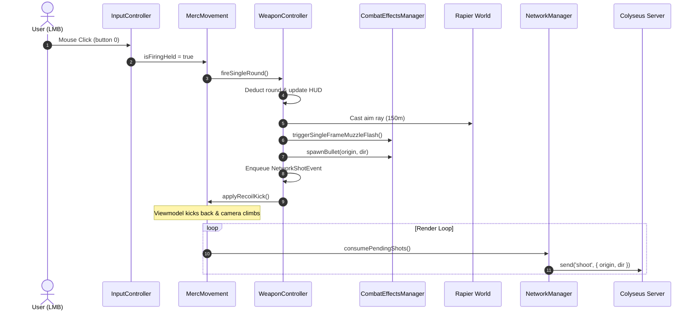
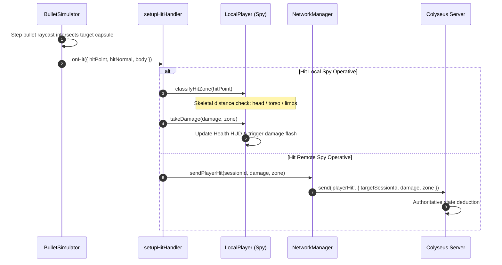
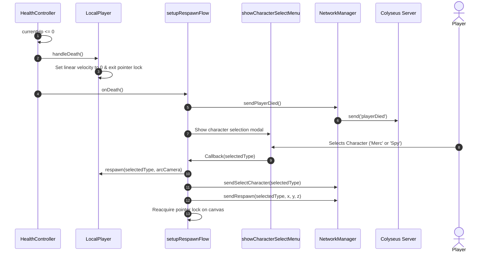

# Architecture & Codebase Guide

This document describes the design, directory structure, layering rules, and lifecycle flows of **Operation DeltaZero** (`multiplayer-cylinder`).

---

## 1. Architectural Principles

1. **Strict Downward Layering**: High-level application orchestrators depend on feature modules, which depend on core foundations. Modules at the same level do not introduce circular peer dependencies.
2. **Barrel Exports**: Every feature directory exposes an `index.ts` barrel representing its public API. External code imports solely from feature barrels.
3. **Single Responsibility & Size Ceilings**: Files maintain a focused responsibility with a target of $\le 300$ lines (hard ceiling of 400 lines) and functions $\le 50$ lines.
4. **Isomorphic Shared Domain**: Wire protocols, hitzone damage calculations, character identifiers, and clamp utilities reside in `shared/` without dependencies on Babylon.js, Rapier3D, Colyseus server internals, or DOM APIs.

---

## 2. Directory Map

```
multiplayer-cylinder/
├── shared/                          # Isomorphic domain shared by client & server
│   ├── types.ts                     # CharacterType, HitZone, shared payload types
│   ├── protocol.ts                  # Protocol message constants and payloads
│   ├── combatConfig.ts              # MAX_HEALTH, hit zone damage mapping
│   ├── utils.ts                     # clamp, sanitizeCharacterType
│   └── index.ts                     # Shared barrel export
│
├── server/                          # Authoritative Colyseus game server
│   ├── index.ts                     # HTTP + Colyseus server bootstrap
│   ├── rooms/
│   │   └── GameRoom.ts              # Lifecycle (onCreate, onJoin, onLeave) & handler wiring
│   ├── handlers/                    # Modular message handlers
│   │   ├── constants.ts             # Arena boundaries & room constants
│   │   ├── characterHandlers.ts     # Character selection and respawn
│   │   ├── movementHandlers.ts      # Position, rotation, and jump replication
│   │   └── combatHandlers.ts        # Shoot replication, damage, and player death
│   └── schema/
│       └── GameState.ts             # Colyseus Schema definitions (Player, GameState)
│
├── src/                             # Client application
│   ├── main.ts                      # Ultra-thin entry point (styles + bootstrap)
│   ├── app/                         # Startup & main render loop orchestration
│   │   ├── bootstrap.ts             # Startup pipeline orchestrator
│   │   ├── scene.ts                 # Engine, Scene, clear color, hemispheric lighting
│   │   ├── cameras.ts               # Third-person orbital & first-person camera setup
│   │   ├── gameLoop.ts              # Render loop: physics -> player -> combat -> network -> render
│   │   ├── hitHandler.ts            # Operative bullet hit dispatching
│   │   ├── respawnFlow.ts           # Death -> character select -> respawn -> pointer lock
│   │   └── index.ts                 # App barrel
│   ├── config/                      # Static configuration & gameplay tuning constants
│   │   ├── arena.ts                 # Arena dimensions, obstacle parameters, gravity
│   │   ├── assets.ts                # GLB asset file paths
│   │   ├── network.ts               # Server WebSocket URL & patch rates
│   │   └── weapons.ts               # Magazine sizes, movement speeds, ADS parameters
│   ├── physics/                     # Rapier3D physics wrapper (no Babylon dependencies)
│   │   ├── world.ts                 # WASM physics world initialization
│   │   ├── colliders.ts             # Ground, obstacle boxes, player kinematic capsule
│   │   ├── grounding.ts             # Raycast ground contact detection
│   │   └── index.ts                 # Physics barrel
│   ├── world/                       # Arena level layout and static geometry
│   │   ├── obstacles.ts             # Deterministic seeded random obstacle specs
│   │   ├── arenaBuilder.ts          # Instantiates Rapier colliders & Babylon meshes
│   │   └── index.ts                 # World barrel
│   ├── player/                      # Operative entity simulation & visual rigs
│   │   ├── LocalPlayer.ts           # Coordinator composing player subsystems
│   │   ├── types.ts                 # Visual and animation interface definitions
│   │   ├── assets/                  # GLB asset loading and vertex normalization
│   │   ├── visuals/                 # Avatar decomposition
│   │   │   ├── hitboxClassifier.ts  # Shared distance & fallback hitzone classifier
│   │   │   ├── spy/                 # Spy multi-track animation & root motion stripping
│   │   │   └── merc/                # Merc viewmodel & world avatar factories
│   │   ├── systems/                 # Composed player controllers
│   │   │   ├── HealthController.ts  # Health points, damage, and health HUD
│   │   │   ├── InputController.ts   # Keyboard & mouse event capture, pointer lock
│   │   │   ├── ViewmodelMotion.ts   # Recoil springs, weapon sway, and ADS alignment
│   │   │   ├── WeaponController.ts  # Magazine state, reload, and ballistics coordination
│   │   │   ├── ParkourController.ts # Ledge raycasting and mantling interpolation curves
│   │   │   ├── MercMovement.ts      # First-person locomotion physics
│   │   │   └── SpyMovement.ts       # Third-person locomotion & camera-locked strafing
│   │   └── index.ts                 # Player barrel
│   ├── combat/                      # Ballistics simulation & combat VFX
│   │   ├── types.ts                 # Active bullet, particle, and hit event types
│   │   ├── muzzleFlash.ts           # Procedural muzzle flash meshes
│   │   ├── effects/                 # Particle pools, impact sparks, barrel smoke
│   │   ├── BulletSimulator.ts       # Raycast projectile stepping
│   │   ├── CombatEffectsManager.ts  # Coordinator for all combat VFX
│   │   └── index.ts                 # Combat barrel
│   ├── network/                     # Colyseus networking & remote replication
│   │   ├── types.ts                 # Remote player tracking interfaces
│   │   ├── remoteVisuals.ts         # Remote avatar creation and animation mapping
│   │   ├── RemotePlayerManager.ts   # Entity interpolation and lifecycle management
│   │   ├── roomHandlers.ts          # Incoming WebSocket message bindings
│   │   ├── NetworkManager.ts        # Client networking coordinator
│   │   └── index.ts                 # Network barrel
│   ├── ui/                          # DOM overlay HUD and menus
│   │   ├── dom.ts                   # HTML element helper lookups
│   │   ├── characterSelect.ts       # Character selection modal dialog
│   │   ├── fpsCounter.ts            # Throttled FPS display
│   │   ├── hud/                     # In-game HUD components (ammo, health, damage flash, crosshair)
│   │   └── index.ts                 # UI barrel
│   ├── utils/                       # Mathematical helpers
│   │   └── math.ts                  # Angle normalization and shortest-arc Y interpolation
│   └── styles/                      # Modular CSS
│       ├── base.css                 # Canvas and viewport styles
│       ├── crosshair.css            # Dynamic reticle styling
│       ├── hud.css                  # Ammo and health gauges
│       ├── menu.css                 # Character select overlay
│       └── index.css                # Style sheet entry
│
└── docs/
    ├── ARCHITECTURE.md              # This document
    └── PROJECT_OVERVIEW.md          # Full architectural audit and baseline inventory
```

---

## 3. Layering & Dependency Rules

Dependencies may only point **downward** in the hierarchy:

```
src/app/
   │
   ▼
src/player/   src/network/   src/combat/   src/world/   src/ui/
   │              │              │             │          │
   └──────────────┴──────────────┼─────────────┴──────────┘
                                 ▼
                     src/physics/   src/config/
                                 │
                                 ▼
                     src/utils/   shared/
```

### Specific Constraints:
- `shared/` must never import from Babylon.js, Rapier3D, the DOM, or Colyseus server.
- `physics/` wraps Rapier3D only; it does not depend on Babylon.js meshes.
- `combat/` must not import from `player/` or `network/`.
- `player/` must not import from `network/` or `app/`.
- `network/` interacts with `player/` strictly through `player/index.ts`.
- No circular dependencies across the entire codebase (verified via DFS cycle detection).

---

## 4. Key Sequence Flows

### 4.1 Weapon Firing & Ballistics Flow



---

### 4.2 Bullet Hit Detection & Damage Resolution Flow



---

### 4.3 Elimination & Respawn Lifecycle Flow



---

## 5. Developer Guide: Where Do I Put New Code?

| Task | Destination File / Directory |
| :--- | :--- |
| **New network message or payload** | `shared/protocol.ts` (constants & interfaces), then `server/handlers/` and `src/network/roomHandlers.ts` |
| **Weapon tuning value (damage, fire rate, ammo)** | `shared/combatConfig.ts` or `src/config/weapons.ts` |
| **New arena obstacle or level parameter** | `src/config/arena.ts` (tuning), `src/world/obstacles.ts` (procedural generation) |
| **Physics collider modification** | `src/physics/colliders.ts` |
| **New animation or character visual rig** | `src/player/visuals/<character>/` |
| **Movement mechanic (e.g. sliding, vaulting)** | `src/player/systems/` (create dedicated system, compose in `LocalPlayer.ts`) |
| **New HUD element or GUI screen** | `src/ui/hud/` or `src/ui/`, styled in `src/styles/` |
| **New particle effect or impact VFX** | `src/combat/effects/` |

